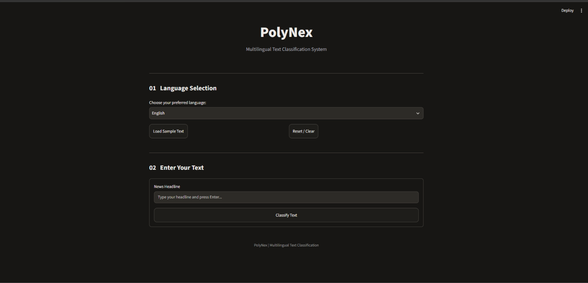
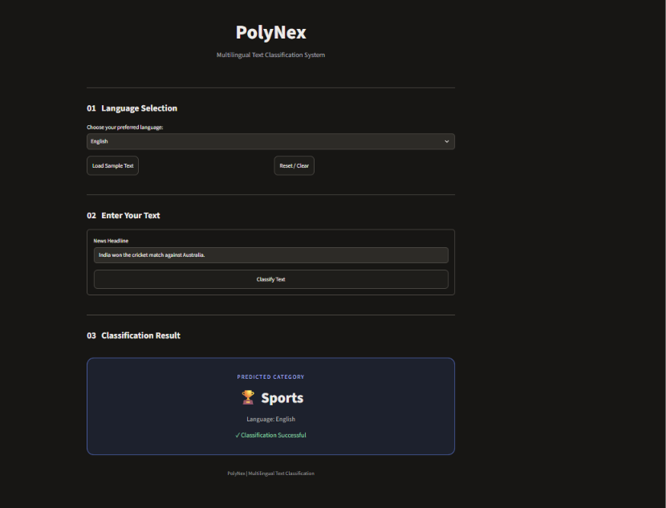
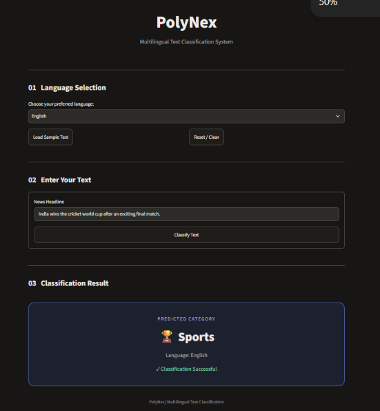
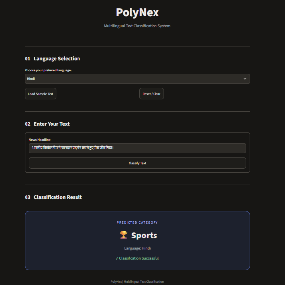
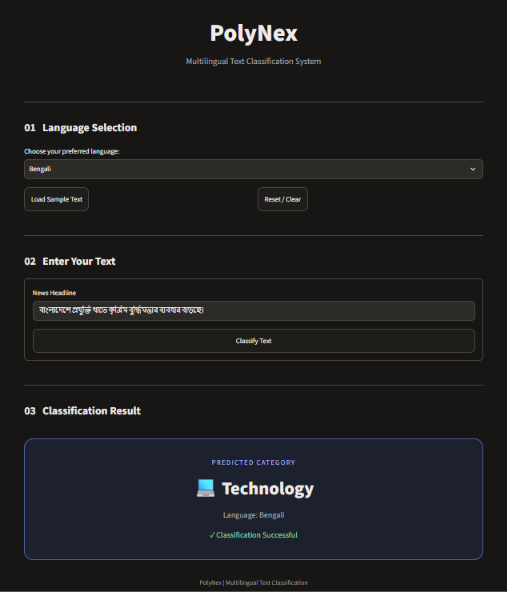
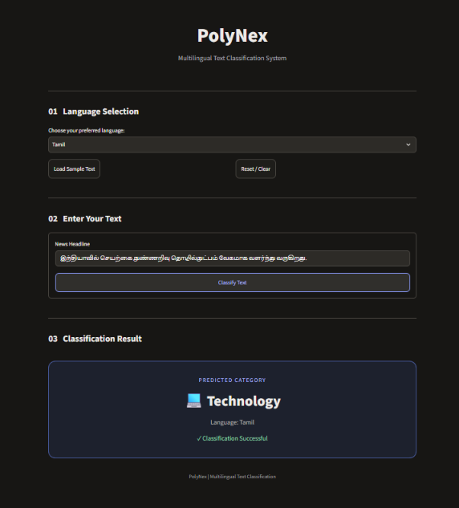

# 🌐 PolyNex – Multilingual Text Classification

An AI-powered multilingual text classification application that classifies news headlines into three categories: Sports, Technology, and Entertainment. The system supports English, Hindi, Bengali, and Tamil using Natural Language Processing and Machine Learning techniques.

## 🎯 Project Objective

To develop an intelligent multilingual text classification application that can identify the category of news headlines across multiple languages and provide quick, accurate predictions through an interactive graphical interface.

## ✨ Features

- Supports four languages: English, Hindi, Bengali, and Tamil.
- Classification into Sports, Technology, and Entertainment.
- Multilingual text preprocessing.
- Unicode character preservation.
- TF-IDF character n-gram feature extraction.
- Linear Support Vector Classifier (LinearSVC).
- Interactive Streamlit-based GUI.
- Language selection before classification.
- Sample headline functionality.
- Instant prediction results.
- Model evaluation using standard classification metrics.
- Language-wise accuracy analysis.
- Data leakage checking between dataset splits.

## 🛠️ Technologies Used

| Technology | Purpose |
|---|---|
| Python | Core programming |
| Streamlit | Web application interface |
| Pandas | Dataset handling |
| NumPy | Numerical operations |
| Scikit-learn | Machine learning |
| TF-IDF Vectorizer | Text feature extraction |
| LinearSVC | Text classification |
| Joblib | Model saving and loading |
| Matplotlib | Data visualization |
| Seaborn | Statistical visualization |

## 🧠 Models Used

**Feature Extraction Model:** TF-IDF Character N-gram Vectorizer

- Analyzer: Character
- N-gram Range: 2–5
- Maximum Features: 300,000
- Sublinear TF: Enabled

**Classification Model:** Linear Support Vector Classifier (LinearSVC)

- C = 1.0
- Class Weight = Balanced
- Random State = 42

## 🌍 Supported Languages and Categories

**Languages:**
- English
- Hindi
- Bengali
- Tamil

**Classification Categories:**
- Sports
- Technology
- Entertainment

The Tamil dataset category `Cinema` is mapped to `Entertainment` to maintain consistent categories across all four languages.

## ⚙️ System Workflow

1. Multilingual news datasets are collected.
2. Data is loaded and analyzed.
3. Missing values and duplicate records are removed.
4. Language-specific categories are mapped into common categories.
5. Text is cleaned while preserving language-specific Unicode characters.
6. Data leakage is checked between training, validation, and testing splits.
7. TF-IDF character n-gram features are extracted.
8. LinearSVC is trained using the processed training dataset.
9. The trained model is evaluated using the test dataset.
10. The model is integrated into the Streamlit application.
11. The user selects a language and enters a headline.
12. PolyNex predicts and displays the classification category.

## 📊 Dataset Information

**Dataset:** L3Cube IndicNews SHC

The project uses multilingual news headline datasets for four languages.

| Dataset Split | Records |
|---|---:|
| Training | 28,285 |
| Validation | 3,378 |
| Testing | 3,304 |
| **Total** | **34,967** |

**Total Languages:** 4

**Total Categories:** 3

## 📈 Model Performance

The trained model achieved **96.91% accuracy** on the cleaned test dataset.

### Overall Evaluation

| Metric | Score |
|---|---:|
| Test Accuracy | 96.91% |
| Test Records | 3,304 |

### Language-wise Test Accuracy

| Language | Accuracy |
|---|---:|
| Bengali | 96.38% |
| English | 96.78% |
| Hindi | 98.92% |
| Tamil | 95.48% |

## 📂 Project Structure

```text
Multilingual-Text-Classification/
│
├── app.py
├── README.md
├── requirements.txt
│
├── data/
│   ├── raw/
│   └── processed/
│
├── models/
│   └── multilingual_text_classifier.joblib
│
├── notebooks/
│
├── reports/
│   ├── dataset_analysis.txt
│   └── evaluation_report.txt
│
├── screenshots/
│   ├── 01_home_screen.png
│   ├── 02_classification_result.png
│   ├── 03_english_test.png
│   ├── 04_hindi_test.png
│   ├── 05_bengali_test.png
│   └── 06_tamil_test.png
│
└── src/
    ├── analyze_dataset.py
    ├── analyze_categories.py
    ├── verify_categories.py
    ├── preprocessing.py
    ├── verify_processed.py
    ├── check_data_leakage.py
    ├── fix_data_leakage.py
    ├── train.py
    └── evaluate.py
```

## 🚀 Installation and Execution

### 1. Clone the Repository

```bash
git clone https://github.com/invictussss/PolyNex-Multilingual-Text-Classification.git
```

### 2. Open Project Directory

```bash
cd Multilingual-Text-Classification
```

### 3. Create Virtual Environment

```bash
python3 -m venv venv
```

### 4. Activate Virtual Environment

```bash
source venv/bin/activate
```

### 5. Install Dependencies

```bash
pip install -r requirements.txt
```

### 6. Run the Application

```bash
streamlit run app.py
```

Open the application in your browser:

```text
http://localhost:8501
```

## 📸 Application Screenshots

### 1. Home Screen



### 2. Classification Result



### 3. English Classification



### 4. Hindi Classification



### 5. Bengali Classification



### 6. Tamil Classification



## 🧪 Testing

The application was tested using sample news headlines in all four supported languages.

Testing included:

- English text classification.
- Hindi text classification.
- Bengali text classification.
- Tamil text classification.
- Sports category prediction.
- Technology category prediction.
- Entertainment category prediction.
- GUI input and classification functionality.
- Sample headline functionality.
- Prediction result display.
- Dataset leakage verification.
- Model performance evaluation.

## ⚠️ Limitations

- Classification is limited to three predefined categories.
- Performance depends on the quality and coverage of the training dataset.
- Unseen words, regional expressions, and spelling variations may affect predictions.
- The application requires the trained model file to be available.
- The current application uses manual language selection rather than automatic language detection.

## 🔮 Future Enhancements

- Automatic language detection.
- Support for additional Indian languages.
- More news classification categories.
- Fine-tuning multilingual transformer models.
- Improved handling of spelling variations and regional expressions.
- Cloud deployment.
- Classification confidence visualization.
- Expanded multilingual datasets.

## 👨‍💻 Project Team

| Student ID | Name |
|---|---|
| 2401730185 | Vikash Kumar |
| 2401730201 | Ankush Sangwan |
| 2401730264 | Palak Kohali |

## 📌 Project Information

**Project Name:** PolyNex – Multilingual Text Classification

**Domain:** Natural Language Processing (NLP)

**Application Type:** AI-Based Web Application

**Course:** Natural Language Processing

**Department:** Computer Science and Engineering (AI & ML)
